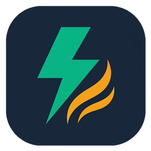

# OmaWatti (Lahti Energia) — Home Assistant -integraatio

[](https://github.com/ManuLaakkonen/ha-omawatti/actions/workflows/validate.yml)
[](https://github.com/hacs/integration)
[](LICENSE)

<p align="center">
  
</p>

Epävirallinen Home Assistant -integraatio **Lahti Energian OmaWatti**-palveluun. Tuo **sähkön** ja **kaukolämmön** kulutustiedot sekä kaukolämmön **vesivirtauksen**, **meno- ja paluuveden lämpötilat** ja **jäähtymän (ΔT)** suoraan Home Assistantin pitkäaikaistilastoihin (*External Statistics*), Energy Dashboardiin ja yhteenvetosensoreihin — ilman selainta ja ilman ulkoisia riippuvuuksia.

> **Huomio / Disclaimer:** Tämä on epävirallinen yhteisöintegraatio, jota Lahti Energia Oy ei virallisesti tue eikä ylläpidä. Integraatio käyttää OmaWatti-portaalin sisäistä REST-rajapintaa maltillisella 6 tunnin kyselyvälillä.

*(English summary at the bottom of this page.)*

---

## Ominaisuudet

- **Suora UI-käyttöönotto (Config Flow):** Syötä OmaWatti-tunnukset käyttöliittymästä — tunnukset tallennetaan HA:n salattuun asetustietokantaan (ei `secrets.yaml`-salasanoja).
- **Automaattinen käyttöpaikkojen tunnistus:** Listaa tilin kaikki aktiiviset sähkö- (`ELE`) ja kaukolämpö- (`HEA`) käyttöpaikat osoitteineen ja deduplikoi saman mittarin myynti-/siirtosopimukset.
- **Tarkat historialliset tuntitilastot (`recorder` External Statistics, HA 2025.11+ / 2026.11+):**
  - Sähkön 15 min mittausdata (`kWh`) summataan tasatunneille UTC-aikaleimoilla (käsittelee kesä-/talviajan siirtymät oikein).
  - Kaukolämpö (`MWh × 1000 → kWh`), vesivirtaus (`m³`) sekä menovesi, paluuvesi ja laskettu jäähtymä `ΔT = T_meno − T_paluu` (`°C`).
  - Suodattaa automaattisesti OmaWatin mittaamattomat `null`-tunnit ja käyttää 10 päivän liukuvaa tarkistusikkunaa, joka paikkaa myöhässä saapuvat lukemat ja huoltokatkot.
- **Yhteenvetosensorit & päivityspainike:** Viimeisin kokonainen päivä, 7 päivän liukuva summa, uusin menovesi/paluuvesi/ΔT sekä *Hae tiedot nyt* -painike.
- **Monivuotinen historiatuonti (`omawatti.import_history`):** Lataa vertailuvuodet kerta-ajolla (esim. `2012-01-01` alkaen) yhtenäisellä kumulatiivisella `sum`-sarjalla ilman vuodenvaihteen negatiivisia piikkejä.

---

## Asennus

### Vaihtoehto 1: HACS (suositeltu)

1. Avaa Home Assistantissa **HACS** → oikean yläkulman **`⋮`** → **Mukautetut tietovarastot (Custom repositories)**.
2. Lisää URL: `https://github.com/ManuLaakkonen/ha-omawatti` ja valitse tyypiksi **Integraatio (Integration)**.
3. Etsi HACS:sta **`OmaWatti (Lahti Energia)`** ja paina **Lataa (Download)**.
4. **Käynnistä Home Assistant uudelleen.**

### Vaihtoehto 2: Manuaalinen asennus (Studio Code Server / SSH / File editor)

1. Lataa tai kloonaa tämä repositorio ja kopioi kansio `custom_components/omawatti/` Home Assistantin `/config/custom_components/omawatti/`-hakemistoon.
2. **Käynnistä Home Assistant uudelleen.**

---

## Käyttöönotto

1. Mene Home Assistantissa: **Asetukset → Laitteet ja palvelut → + Lisää integraatio → `OmaWatti (Lahti Energia)`**.
2. Syötä OmaWatti-käyttäjätunnus ja salasana.
3. Valitse seurattavat käyttöpaikat ja ensituonnin alkupäivämäärä (oletus kuluvan vuoden alku, esim. `2026-01-01`).
4. Paina **Lähetä** — ensihaku kestää n. 5–15 sekuntia käyttöpaikkojen määrästä riippuen.

---

## Energy Dashboard & oma `Energia`-välilehti

Integraatio luo ulkoiset tilastot muodossa:
- `omawatti:<katunimi>_electricity` (`kWh`)
- `omawatti:<katunimi>_heat_energy` (`kWh`)
- `omawatti:<katunimi>_heat_waterflow` (`m³`)
- `omawatti:<katunimi>_heat_water_in` (`°C`)
- `omawatti:<katunimi>_heat_water_out` (`°C`)
- `omawatti:<katunimi>_heat_delta_t` (`°C`)

### 1. Kytkeminen Energy Dashboardiin
1. Avaa **Asetukset → Kojelaudat → Energia**.
2. Lisää **Sähköverkko → Kulutus**: valitse `omawatti:<kohde>_electricity`.
3. Lisää **Kaasu** *(HA:ssa ei ole omaa kaukolämpöosiota, mutta Kaasu hyväksyy `kWh`-yksikön)*: valitse `omawatti:<kohde>_heat_energy`.

### 2. Vinkki: Oma `Energia`-välilehti ilman "Kaasu"-otsikkoa
Jos haluat Energy Dashboardin interaktiivisen aikavalitsimen ja vertailutyökalun, mutta haluat otsikoksi **Kaukolämmön kulutus** sanan *Kaasu* sijaan, lisää omalle `sections`-välilehdelle HA:n natiivit energiakortit:

```yaml
type: energy-date-selection
---
type: energy-compare
---
type: energy-usage-graph
title: Sähkön kulutus
---
type: energy-gas-graph
title: Kaukolämmön kulutus
---
type: energy-sources-table
title: Valitun jakson lähteet
```

Kaukolämmön jäähtymän seurantaan sopii natiivi `statistics-graph`:

```yaml
type: statistics-graph
title: Menovesi, Paluuvesi & Jäähtymä — 14 pv (°C)
chart_type: line
period: hour
days_to_show: 14
stat_types:
  - mean
entities:
  - entity: omawatti:<kohde>_heat_water_in
    name: Menovesi
  - entity: omawatti:<kohde>_heat_water_out
    name: Paluuvesi
  - entity: omawatti:<kohde>_heat_delta_t
    name: Jäähtymä ΔT
```

> **Huom:** Koska OmaWatti-data tulee 1–2 päivän viiveellä, kuluva päivä näyttää tyhjää — valitse yläpalkista **Viikko**, **Kuukausi**, **Vuosi** tai siirry päivä taaksepäin (`←`).

---

## Vertailuvuosien lataaminen (`omawatti.import_history`)

Voit ladata aiempien vuosien tuntihistorian kerta-ajona Energy Dashboardin vuosivertailua varten:

1. Avaa **Työkalut → Toiminnot** *(Developer Tools → Actions)*.
2. Valitse toiminto **`OmaWatti: Tuo historiatiedot (backfill)`** (`omawatti.import_history`).
3. Syötä **Alkupäivämäärä** (esim. `2022-01-01` tai vanhempi) ja paina **Suorita toiminto**.
   - Palvelu hakee datan vuosierissä aina tähän päivään asti ja laskee kumulatiivisen `sum`-kertymän yhtenäisesti alusta loppuun → vuodenvaihteisiin ei synny negatiivisia piikkejä.
   - Usean vuoden haku kestää taustalla tyypillisesti 30–120 sekuntia. Aja backfill vain tarvittaessa kerta-ajona.

---

## Tiedossa olevat rajoitteet (v1.0)

- **Aurinkosähkön ylijäämämyynti (`microGeneration`):** Versio 1.0 tuo ostetun sähkön kulutuksen (`electricity-consumption`), ei vielä verkkoon syötettyä tuotantoa.
- **Käyttöpaikkojen muokkaus jälkikäteen:** Käyttöpaikkojen lisääminen/poistaminen tehdään tällä hetkellä poistamalla ja lisäämällä integraatio uudelleen (tietokantaan tallennetut tilastot säilyvät silti).
- **Paikallinen kuvake:** Näkyy automaattisesti Home Assistant **2026.3+** -versioissa (`custom_components/omawatti/brand/`).

---

## Kehitys ja testaus

```bash
python -m unittest discover -s tests -v
```

---

## English Summary

Unofficial Home Assistant custom integration for **Lahti Energia OmaWatti** (Finland).

- Imports **15-minute electricity consumption** (aggregated to UTC hourly `kWh`), **hourly district heating energy** (`MWh → kWh`), **water flow** (`m³`), **supply/return water temperatures** and **cooling ΔT** (`°C`) directly into Home Assistant **External Long-Term Statistics** (`StatisticMeanType` + `unit_class` compatible with HA `2025.11+` and `2026.11+`).
- Zero external Python dependencies (`aiohttp` from HA Core), UI Config Flow with multi-meter discovery and re-auth, summary dashboard sensors, manual refresh button, and `omawatti.import_history` action for seamless multi-year historical backfills without year-boundary spikes.
- Install via **HACS → Custom repositories** (`https://github.com/ManuLaakkonen/ha-omawatti`, category *Integration*) and restart Home Assistant.
